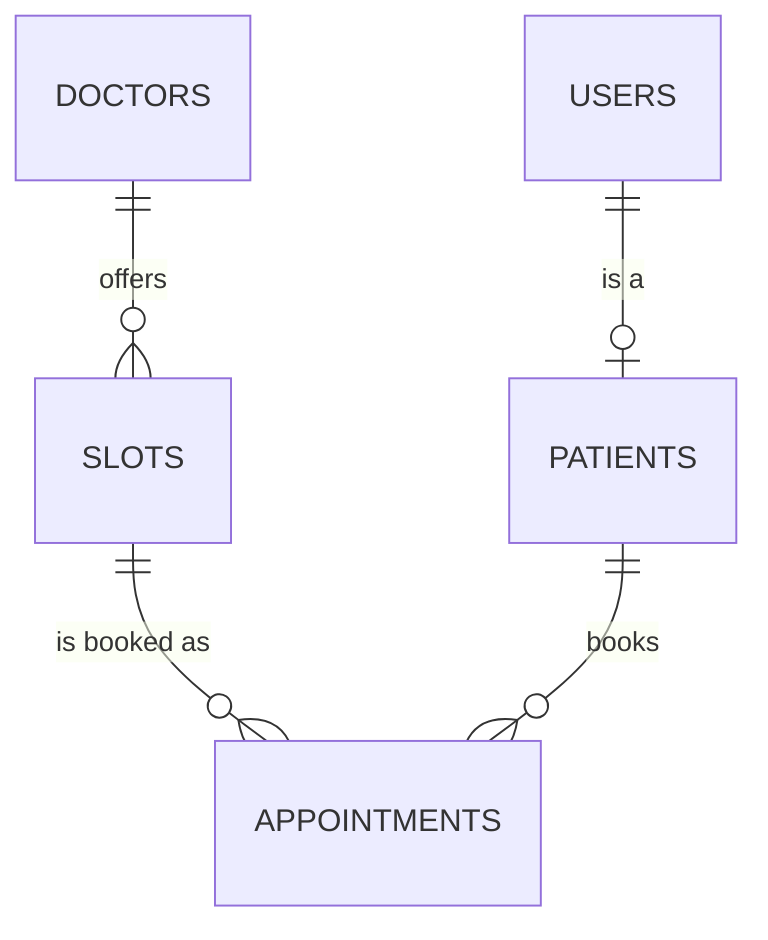

# ClinicSlots: appointment booking for a small clinic

One of the three capstone briefs. Read the [capstone README](../README.md) first: it explains the plan, `PROGRESS.md` and the AI rules.

**Stack:** FastAPI, PostgreSQL, SQLAlchemy and Alembic, React with TypeScript. The same as RailSeat.
**The one hard rule:** no two patients ever hold the same doctor's slot.

## The problem

A clinic in Pune has three doctors and one receptionist. Patients phone to book, and the receptionist writes each booking in a paper register. On busy mornings the phone rings without stop, and two patients are given the same time. Patients wait without knowing when their turn comes.

ClinicSlots lets a patient see a doctor's free 15-minute slots and book one online, and gives the receptionist one list of the day's appointments.

## Who uses it

- **Patient:** books, cancels and sees their own appointments. Often on a phone, often in a hurry.
- **Receptionist:** sees every appointment of the day, marks patients as arrived, and books for patients who phone.
- **Doctor** (nice-to-have): sees only their own appointments for the day.

## User stories

Pick 6 to 10 of these for your plan, and write your own acceptance criteria. **Core** ideas make a good Must list (at most 6); **extra** ideas are Nice stories. The examples show the level of detail.

| # | Story idea | Kind |
|---|---|---|
| S01 | As a patient, I want to sign up and log in (or pick a seeded demo patient: sign-in is optional), so that my appointments are mine alone. | core |
| S02 | As a patient, I want to see a doctor's free slots for a date, so that I can choose a time. | core |
| S03 | As a patient, I want to book a free slot, so that I do not queue at the clinic. | core |
| S04 | As a patient, I want to see my upcoming appointments, so that I remember them. | core |
| S05 | As a patient, I want to cancel an appointment up to 2 hours before it, so that someone else can have the slot. | core |
| S06 | As a receptionist, I want to see every appointment of a day, grouped by doctor, so that I can run the waiting room. | core |
| S07 | As a receptionist, I want to mark a patient as arrived or as a no-show, so that the doctor knows who is waiting. | extra |
| S08 | As a receptionist, I want to book a slot for a patient who phones, so that phone patients use the same list. | extra |
| S09 | As a doctor, I want to see only my own appointments for today, so that I know who comes next. | extra |
| S10 | As a patient, I want to move my appointment to another free slot in one step, so that I do not lose my place if the new slot is gone. | extra |

Example acceptance criteria for S03:

- Given Dr Rao's 09:30 slot on 2 December is free, when I book it, then I see "Booked: Dr Rao, 2 December, 09:30" and the slot leaves the free list.
- Given that slot was booked a moment ago by someone else, when I book it, then I see "This slot is no longer free" and the free slots again, and nothing is booked for me.
- Given I am not logged in, when I try to book, then I am sent to the log-in page.

## Must-haves and nice-to-haves

**Core (week 8, tasks 5 to 9):** sign-up and log-in with two roles (patient, receptionist), or seeded demo users (sign-in is optional); slots made from seed data; free slots by doctor and date; booking with the hard rule; my appointments; cancelling; the receptionist's day list; the hard-rule test.

**Extra (only if the core is done and tested):** arrived and no-show; receptionist booking for a patient; a doctor role; moving an appointment; a weekly schedule screen for the admin that makes the slots.

**Not in this capstone:** payments, SMS or email reminders, medical notes and prescriptions, file uploads, a live queue screen.

## Suggested tables

Your ER diagram adds the attributes and keys. Keep times as `timestamptz` and in India time on screen.

| Table | What it holds | Key columns |
|---|---|---|
| `users` | Sign-in, as in RailSeat | `id`, `email` (unique), `password_hash`, `role` (`patient`, `receptionist`, `doctor`) |
| `patients` | A patient's profile | `id`, `user_id` (unique), `name`, `phone` (made up) |
| `doctors` | The clinic's doctors | `id`, `name`, `speciality` |
| `slots` | One 15-minute slot of one doctor | `id`, `doctor_id`, `starts_at`; unique (`doctor_id`, `starts_at`) |
| `appointments` | A booking of one slot | `id`, `slot_id`, `patient_id`, `status` (`booked`, `cancelled`, `arrived`, `no_show`), `created_at` |

A seed script makes the slots: three doctors, 09:00 to 13:00, every 15 minutes, for the next 14 days. That is 16 slots a doctor a day.

## The one hard rule

**No two patients ever hold the same doctor's slot.** A cancelled appointment frees its slot for someone else.

**A worked example.** Dr Rao's slot on 2 December at 09:30 has id 41. Meera books it: one appointment, slot 41, status `booked`. A second later Kabir tries slot 41: he gets 409 "This slot is no longer free", and slot 41 still has one active appointment. Meera cancels; her row stays with status `cancelled`, and now Kabir can book slot 41.

**A hint about constraints** (the same idea as RailSeat's seats):

- A **partial unique index** on `appointments (slot_id)`, covering only the rows whose status is not `cancelled`: at most one active appointment per slot. Autogenerate misses the `WHERE` part of a partial index, so write it into the migration by hand, as the CP1 task 5 brief shows.
- The booking endpoint inserts the appointment in one transaction. When the index refuses the insert, SQLAlchemy raises `IntegrityError`: catch it, roll back, and answer **409** with a clear message.
- Checking "is the slot free?" with a `SELECT` first and then inserting is **not** enough on its own: two requests can both see the slot as free. The index is what makes it safe.

How to prove it with a test (`capstone/api/tests/test_hard_rule.py`, CP1 task 7), as in P2 task 20:

1. Seed one doctor, one slot and 20 patients.
2. Send 20 `POST /appointments` for that slot at the same moment, with `asyncio.gather`, each as a different patient.
3. Assert exactly one `201` and nineteen `409`.
4. Assert the database holds exactly one appointment for that slot that is not cancelled.
5. A second test: cancel that appointment, book the slot again as another patient, and expect `201`.

## Two-week scope

| When | Task | What you build |
|---|---|---|
| Week 8, day 1 | Choose and plan | `PLAN.md`: product, rule, stories, screens and Build plan; mentor approval (tables come in task 5, endpoints in task 6) |
| Week 8 | Model the data | The four tables plus `users`, the migration with the partial unique index, the slot seed script |
| Week 8 | Core API | Sign-up and log-in, `GET /doctors`, `GET /doctors/{id}/slots?date=`, `POST /appointments`, `GET /appointments/mine`, `POST /appointments/{id}/cancel` |
| Week 8 | Tests | The hard-rule test above, plus the 2-hour cancel rule and "a patient sees only their own appointments" |
| Week 8 | Main screen | Choose a doctor and a date, see the free slots, book one, and see the lost-slot message |
| Week 8 | Second feature | The receptionist's day list (`GET /appointments?date=`, receptionist only) |
| Week 9 | Ship it | Compose, one Playwright test of booking, polish, the deploy in [`deploy/README.md`](../../deploy/README.md), the README and the talk |

## What "done" looks like at the demo

In three minutes, with two browsers open:

1. Two patients open Dr Rao's free slots for tomorrow. Both choose 09:30. One gets "Booked"; the other sees "This slot is no longer free" and a fresh list.
2. Run the hard-rule test: one `201`, nineteen `409`.
3. Log in as the receptionist and show the day list.
4. Show the live HTTPS address, then the teardown evidence.

## Data and privacy

Health data is personal data, and India's Digital Personal Data Protection Act, 2023 protects it. Use made-up patients only: no real names, phone numbers, Aadhaar numbers or medical details. Store no reason for the visit. Make test patients with your seed script, and keep every secret out of Git.
